# Carlink

The Carlink app makes the Apple Carplay experience on a 2024+ Chevy Silverado or GMC Sierra functionally similar to the native Android Auto (AA) experience.  It enables you to have a full screen Carplay experience, with HUD features that previously were only AA capable.  In addition to enabling these features, this app enhances the HUD by allowing you to customize many of the HUD settings to your preference.

It also has a Media side pane that is much more functional and appealing than the Carplay NowPlaying Widget.  This media side pane also includes the ability to display lyrics, for those trips that your passengers need assistance with! ;)

**Media Pane Enabled:**

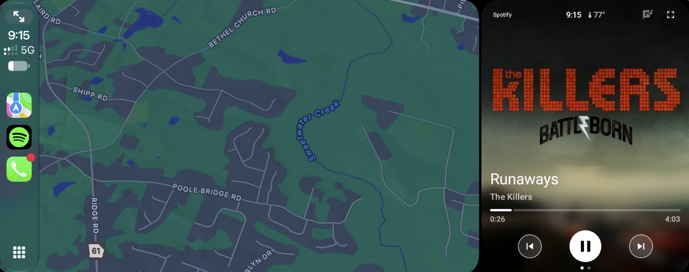

**Lyrics Enabled:**

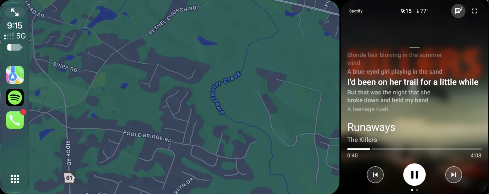

**NOTE**: this Carlink is the successor to [Carlink-legacy](https://github.com/enigy/Carlink-legacy) app, which stays on stock/v5 Carlinkit adapter firmware and is unchanged by this project.

## How it works

It runs on GM's AAOS head unit (GM Info 3.7) with a Carlinkit CPC200-CCPA adapter, powered by **lvalen91's open OCBM stack** instead of stock Carlinkit firmware.

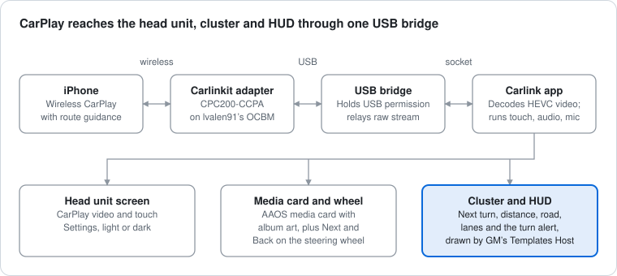

The iPhone talks to the adapter wirelessly, and the adapter plugs in over USB. The app has no USB access of its own, so the bridge relays the raw stream to it over a socket. Carlink renders CarPlay, runs the media card and feeds GM's Templates Host, which draws the cluster and HUD.

## Your Carplay, upgraded

Carplay can now run fullscreen on your GM AAOS headunit.  No more 8 in box limitation for Carplay, or having to dodge the AAOS navigation and notification bars.  You get full screen access to Carplay, the way Apple meant it to be!

In addition, you now have the capability of adding a media pane on the side, similar to Android Auto.  This new media pane offers much more than the stock GM side pane, and also allows you to show lyrics, outside temperature, and more.

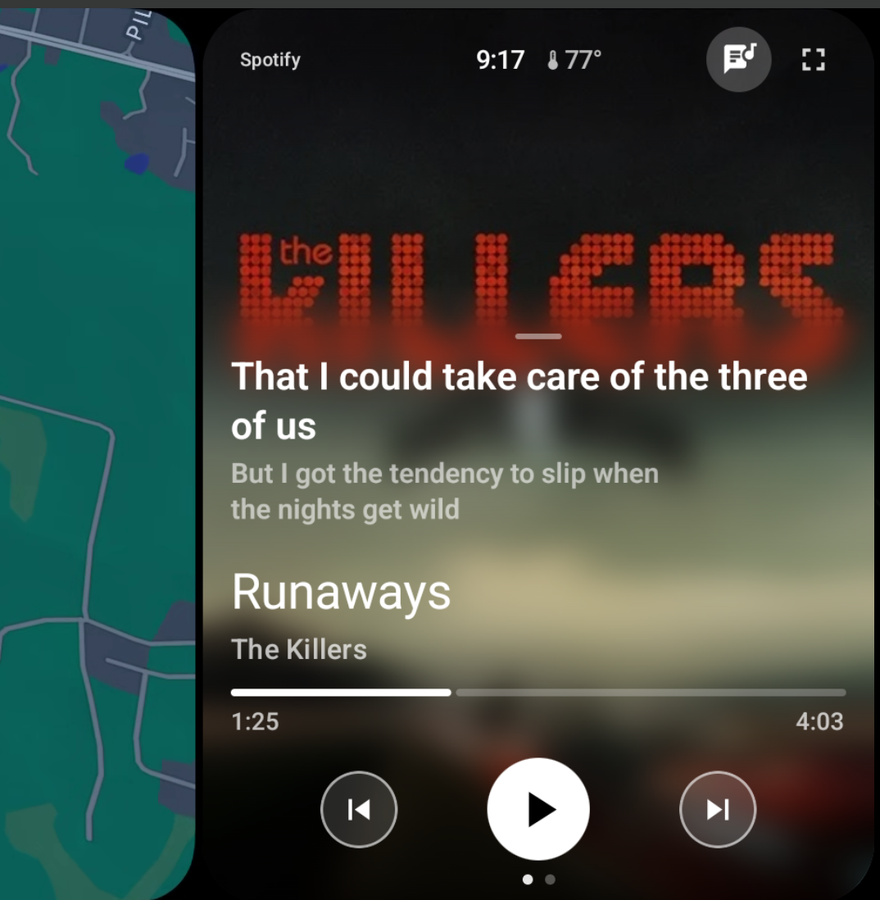

## Your cluster and HUD, upgraded

Turn on **Settings › Cluster › Directions on cluster** and CarPlay's route lands on GM's driver display: turn card, distance, road and lanes, drawn by GM itself.

GM's native Carplay experience strips lane guidance from the vehicle's Cluster and HUD screens.  But with Carlink, we can deliver this capability to the Cluster and HUD

Picture from a live HUD navigation session:

> 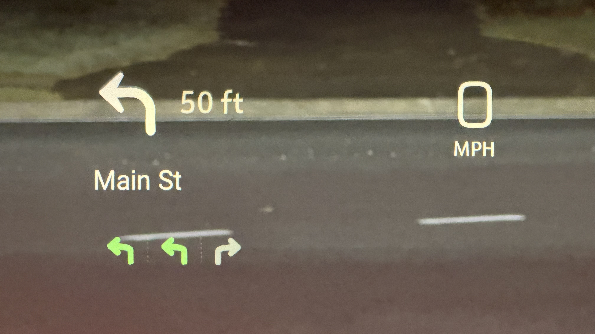

### Turn icons that match the road

Every icon is drawn from the junction Apple sends with the maneuver, at the real exit angle: sharp turns look sharp, slight turns look slight. Side roads are left out, so the arrow fills the icon. Roundabouts keep their ring and exit. No junction data? Each maneuver type falls back to its own fixed icon.

### Lane guidance

Know your lane before the exit. **Settings › Cluster › Lane guidance**, kept for each iPhone:

| Setting | Factory setting | What it does |
| --- | --- | --- |
| Ask iPhone for lanes | On | Asks the iPhone for lane guidance from the next connection (Reset connection applies it now). Turns itself off if the iPhone refuses. Needs an adapter built with the lane guidance change. |
| Lanes in the turn icon | Off | Off; Arrow over lanes (the turn arrow on top, the lanes beneath); or Lanes only. |
| Separate lane strip for GM | On | Sends the lanes to GM's own lane area under the turn. |
| Lanes to be in | White | White, red, amber, green, cyan or magenta. |

Settings also shows the last lanes the iPhone sent, or why none have arrived.

The lane strip is always 6:1. GM fits it into a lane area at most 74 dp tall (the Car App Library's 500 × 74 dp box), and a calibration card in the lane area showed 6:1 is the widest shape that keeps that height. The lanes share the full width, each arrow centered and widened to fill its lane, so turns read wider than they are tall.

> 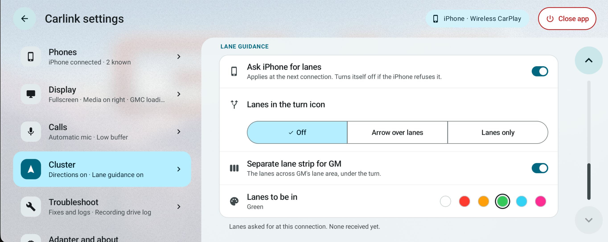

### Turn alert

Get a heads-up before your turn. **Settings › Cluster › Turn alert** (off by factory setting, kept for each iPhone) flashes the turn icon between its normal frame and a colored one as you close in on the next turn or exit. The faster you go, the earlier it starts:

| Start alerting | Up to 35 mph | 36–59 mph | 60–69 mph | 70 mph and up |
| --- | --- | --- | --- | --- |
| Earlier | 1,000 ft | 2,000 ft | 3,000 ft | 5,200 ft |
| Standard | 500 ft | 1,000 ft | 1,500 ft | 2,600 ft |
| Later | 300 ft | 600 ft | 900 ft | 1,560 ft |

Carlink can read the truck's speed, so make it yours:

- **Flash speed:** one flash every 1.5, 1 or 0.5 seconds.
- **Inlay color:** red, amber, green, cyan or magenta.
- **Style:** Inlay colors the inside of the arrow; Outline adds a colored edge too.
- **Solid for the last 3 seconds:** holds the colored frame just before the turn.

Nothing flashes when you're stopped, on straight-ahead or follow-the-road steps, or on arrival.

> 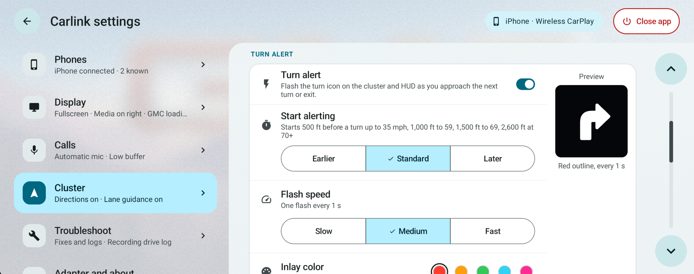

## A tour of the new Settings page:

One screen runs the whole show now. Categories sit on the left, each with a live summary, and the one you pick opens on the right. It follows the head unit's light or dark theme.

### Settings for each iPhone

Each iPhone brings its own settings, keeping its own **Directions on cluster**, **Lane guidance**, **Turn alert** and **Limit CarPlay while driving**. Settings shows the iPhone connected now, or the last one that connected. Display mode, driver's seat, loading screen, calls, phones and logs stay shared by everyone.

A new iPhone starts from the factory settings: directions on, lane guidance on, turn alert off, CarPlay limited while driving. While parked, the bar at the top of Cluster lets you switch to another iPhone's settings to change them, copy one iPhone's settings to another, or reset an iPhone to factory settings. While driving, Settings shows only the iPhone in use.

> 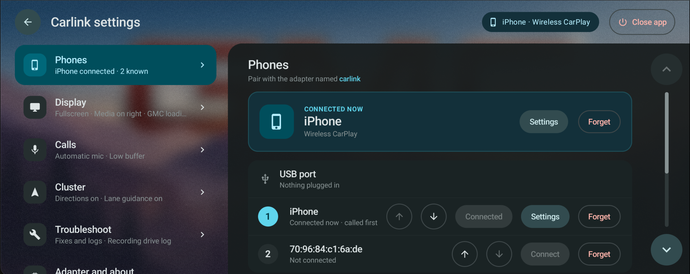

> 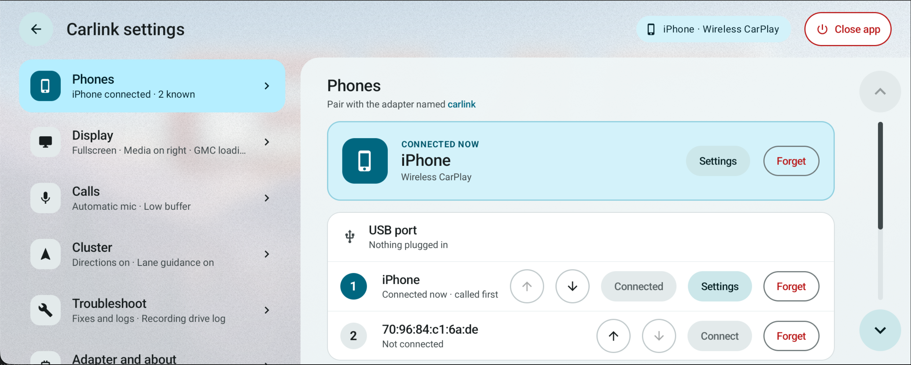

### Phones

The connected phone, with **Settings** and **Forget**; your other known phones and the USB port; the order the adapter calls paired phones in, plus **Connect automatically**; and **Add phone**. Once a phone is paired, a new one can pair only while Add phone holds the adapter's Bluetooth pairing open, for 2 minutes. Forgetting a phone also deletes its settings.

> 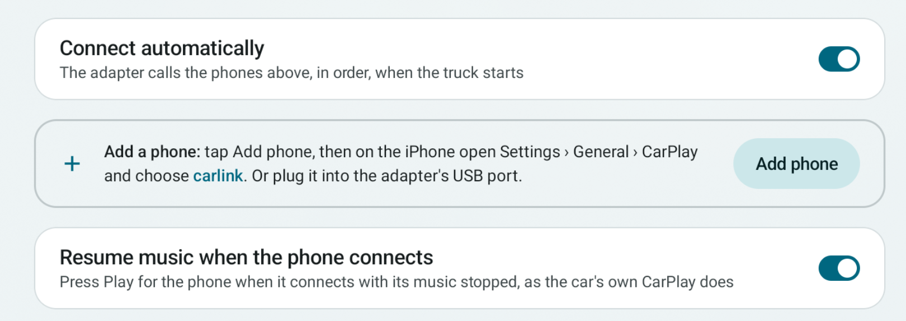

### Display

Display mode, the loading screen photo, the driver's seat, and **Limit CarPlay while driving**: when it's on, CarPlay hides its keyboard and shortens lists while the truck moves.

> 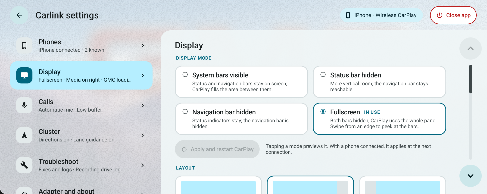 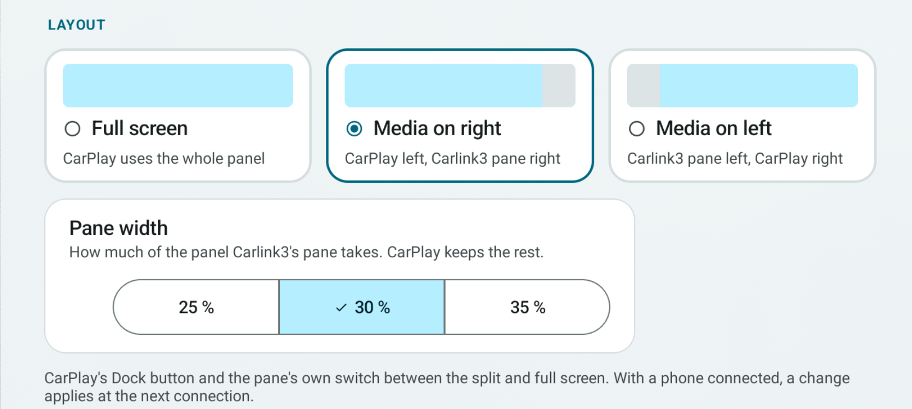 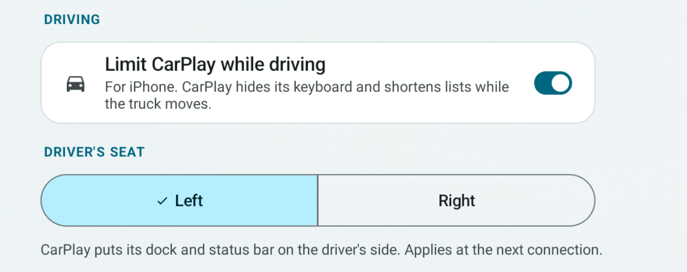 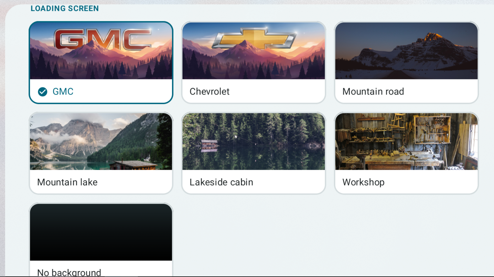

### Calls

The call microphone, the call audio buffer, and echo and voice tests.

> 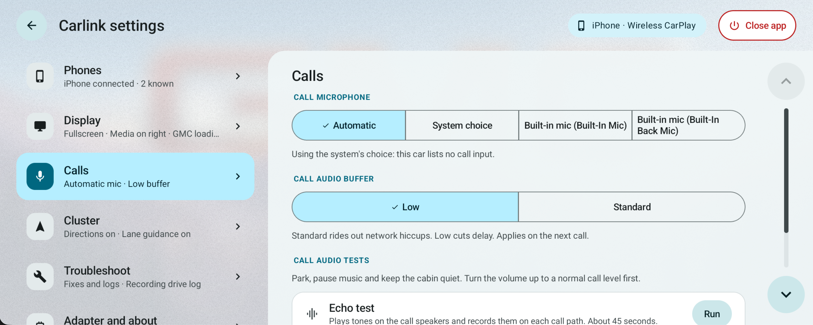

### Cluster

**Directions on cluster**, **Reconnect cluster**, the **Turn alert** with a live preview of the flash, and **Lane guidance**.

> 

> 

### Troubleshoot

Fixes run from least to most disruptive, and each one that interrupts CarPlay asks first:

1. Reset video
2. Restart wireless
3. Reset connection
4. Reboot adapter
5. Disconnect adapter

Below them are the logs:

- **Detailed logging**
- **Record drive logs:** writes the app's and the adapter's logs to `Downloads/Carlink` as you drive, and keeps them 7 days.
- **Copy logs to USB** (parked only)
- **Save logs:** saved logs hide phone names and Bluetooth addresses.

### Adapter and about

The app version, the adapter's name and mode, and its health: Bluetooth, Wi-Fi, CarPlay and firmware.

## Install in four steps

First, the adapter needs lvalen91's OCBM userspace, installed per his documentation (`ocbm/docs/ops/`). Then:

1. Install Carlink from Google Play.
2. Copy [`app/carlink_bridge.apk`](app/carlink_bridge.apk) (Carlink USB Bridge 1.0.5) to a USB drive. SHA-256: `d5a4f48cd2dc668caa1e97cee0fe63334a574c6c7e3b0e11695aa45e930f1e79`
3. While parked, open Carlink. It shows **USB bridge not installed** with an **Open Files** button that opens the head unit's hidden Files app. Insert the USB drive, open the drive and tap the APK. If asked, allow Files to install apps.
4. When the install finishes, tap the Carlink notification (or press Home and open Carlink).

### About the bridge

The bridge uses the same package name as Carlink2's (`android.car.usb.handler`, the name GM's head unit hands USB devices to) and answers only Carlink, so installing it replaces Carlink2's (carlink-legacy) bridge. From 1.0.4 it answers only a Carlink signed by this project (the Play app-signing or upload certificate, pinned in `bridge/build.gradle.kts`), or one installed by the Play Store.

### Check the download

| System | Command |
| --- | --- |
| macOS | `shasum -a 256 carlink_bridge.apk` |
| Linux | `sha256sum carlink_bridge.apk` |
| Windows PowerShell | `Get-FileHash carlink_bridge.apk -Algorithm SHA256` |

Each [GitHub Release](https://github.com/enigy/carlink/releases) also attaches the bridge as `carlink_bridge-<version>.apk`. The release workflow rebuilds it only when `bridge/` or `bridge-api/` changed since this file was last committed; otherwise it attaches this file. So the hash above holds until the next bridge change (v111 built 1.0.5; earlier releases' attachments have their own hashes). When the bridge changes, replace `app/carlink_bridge.apk` with the release's signed APK and update the version and SHA-256 above.

## Under the hood

**Version 2.00**, out through Google Play internal testing and tested in the truck with every release. `:app`, `:bridge` and `:bridge-api` build; ktlint, detekt, Android lint and **513 unit tests** pass.

### Adapter

The adapter runs lvalen91's OCBM userspace, installed and recovered per his documentation (`ocbm/docs/ops/`). Add phone and the phone order appear only when the adapter reports that it supports them. Lane guidance from the iPhone needs an adapter built with the lane guidance change.

### Modules

| Module | Role |
| --- | --- |
| `:app` | Display app (`com.enigy.carlink3`). Decodes HEVC CarPlay over OCBM, renders, handles touch/audio/mic, drives the AAOS media card and the cluster/HUD turn-by-turn via the Templates Host. Play-shippable. |
| `:bridge` | Sideloaded USB bridge, package `android.car.usb.handler`. Holds the adapter's USB permission silently on every attach, relays the raw OCBM bulk stream to the app over a socket, and hosts the cluster icon `ContentProvider`. |
| `:bridge-api` | AIDL contract between the two. |

Removed from OCBM: `:projection` (Raspberry Pi target), `:car-system-stubs` (system APIs a third-party app cannot hold) and `:usbhandler` (OCBM's untested proof of the permission grant, superseded by `:bridge`).

### Engineering notes

- **Transport:** the bridge relays the adapter's bulk stream raw (API 3), and the app reaches it through `BridgeBulkTransport`, an implementation of OCBM's `RawBulkTransport`; `OcbmClient` is unchanged. The bridge is required: the app has no USB access of its own (no USB permission, no USB dialog, no claim on the device), like Carlink2 since its [204]. The bridge gets USB permission silently on every attach and shows a one-tap prompt for an adapter that attached during boot.
- **Cluster/HUD navigation:** Carlink2's Templates Host pipeline (`cluster/`, `navigation/`, the compose icon store) is the base. `navigation/OcbmNavigationFeed` turns the box's `routeGuidance` / `maneuver` JSON (`CH_METADATA`) into the `NavigationState` it renders, including the exit label ("Exit 123 · John Smith Rd") and the lanes. Junction spoke angles (`junctionAngles` / `junctionExitAngle`) are consumed when the box emits them: that is the `patches/ocbm/` change, on the fork's `route-guidance-exitinfo-angles` branch. Against an unpatched box, roundabout icons fall back to the static glyph per maneuver type.
- **CI and protocol drift:** `.github/workflows/gate.yml` runs the same gate as local on every push and PR. It first runs `tools/proto_check.py`, which compares the Kotlin `OcbmProto.kt` against the reference copy of OCBM's canonical table in `proto/` (OCBM's own checker only sees clients inside its repo). Refresh `proto/ocbm-proto.lib.rs` whenever the box is rebuilt from a newer OCBM.
- **Style gates:** files ported byte-identical from Carlink2 are excluded from ktlint in `.editorconfig` (`ktlint = disabled` per file), and their detekt findings are baselined. Carlink2 ran ktlint with `ignoreFailures=true`, so it never shaped them. Everything written for Carlink is gated.

See `NOTICE.md` for provenance.

## Releasing

`.github/workflows/release.yml` is Carlink2's release pipeline with the names changed. It signs the `sideloadRelease` AAB and the bridge APK with the upload key from the `CARLINK_*` secrets, uploads the AAB to Google Play (`com.enigy.carlink3`) and attaches both to a GitHub Release.

- **Version:** `appVersionCode` in `app/build.gradle.kts` is the only number to bump. `versionName` derives from it (100 is 1.00, 101 is 1.01), and the release tag must be `v<appVersionCode>`.
- **Tag push `vNNN`:** build, upload to Internal testing, GitHub Release. **Manual run** from main: pick the track; untick *Upload* to build only. Runs from other branches never upload.
- **Naming a release:** the bump commit carries the summary (`[7] Connecting screen, call-audio choices`, not `Bump appVersionCode`), since it is the workflow run's title. The annotated tag's message becomes the GitHub Release title and intro (`git tag -a v7 -m "Carlink v7: …"`).
- **Play Console, once:** create the app (`com.enigy.carlink3`), grant the existing service account release rights to it, and upload the first AAB from the workflow artifact by hand. The API only accepts drafts until an app has been rolled out once (the step then fails with `status=completed`; rerun after the first manual rollout). The bridge's caller pins are committed in `bridge/build.gradle.kts`; a `CARLINK3_CALLER_CERTS` repository variable replaces the release list.
- **Local release builds** need a `keystore.properties` next to `settings.gradle.kts` (gitignored, same keys the workflow writes). Without it, release variants build unsigned and debug is unaffected.

## License

Public domain (Unlicense), like both parents.
